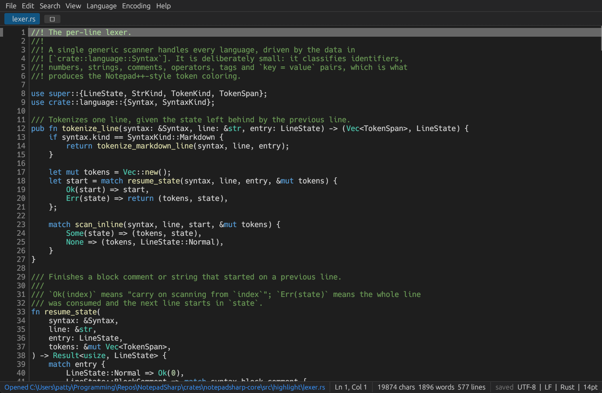

# NotepadSharp

A Notepad++-style text editor written in Rust, built on [`egui`/`eframe`](https://github.com/emilk/egui).

Multiple tabs, syntax highlighting for 23 languages, line numbers, incremental find & replace
with regular expressions, encoding and line-ending control, and a remembered session — all in
one ~2 MB native binary.



## Running it

```powershell
cargo run --release                          # empty editor
cargo run --release -- path\to\file.rs       # open one or more files
cargo test                                   # 90 tests, no GUI required
```

The release binary ends up in `target\release\notepadsharp.exe`.

## Features

**Editing**
- Multi-tab editing with dirty markers, middle-click close, a tab context menu, reopen-closed-tab
  and Ctrl+Tab cycling
- Undo/redo with word-sized coalescing, shared by typing, pastes and every line operation
- Soft tabs (configurable width) or hard tabs; Tab/Shift+Tab indents or unindents the selection
- Line operations: duplicate, delete, move up/down, toggle comment, sort, trim trailing whitespace,
  UPPERCASE/lowercase/Title Case, tabs↔spaces conversion
- Current-line highlight, line-number gutter, vertical/horizontal scrolling, word wrap, zoom

**Highlighting**
- 23 languages: Rust, Python, JavaScript, TypeScript, C, C++, C#, Java, Go, HTML, XML, CSS, JSON,
  YAML, TOML, Markdown, SQL, Shell, Lua, PHP, INI, Batch and plain text
- Incremental, Scintilla-style line-state highlighter: block comments, nested constructs and
  multi-line strings are tracked across lines, and only changed lines are re-tokenized
- Language is detected from the extension, or from a `#!` shebang, and can be overridden per tab

**Search**
- Find / Replace panel with literal, whole-word and regex modes, match case, wrap-around,
  match counter and all-matches highlighting (the active match is highlighted stronger)
- Regex replacements support `$1` capture references; literal modes insert the replacement verbatim
- Go to line (Ctrl+G)

**Files & text**
- Encoding detection (UTF-8, UTF-8 BOM, UTF-16 LE/BE, Windows-1252 fallback) and conversion
- Line endings are detected (LF / CRLF / CR), preserved on save, and can be converted
- Session restore: open files, active tab, recent files, theme, font size, wrap and window size
- Files can be opened from the command line, the Recent files menu, or by dragging them onto the window
- Unsaved-changes prompts on tab close and on exit

## Keyboard

| Keys | Action |
| --- | --- |
| `Ctrl+N` / `Ctrl+O` | New file / open file |
| `Ctrl+S` / `Ctrl+Shift+S` / `Ctrl+Alt+S` | Save / save as / save all |
| `Ctrl+W` / `Ctrl+Shift+T` | Close tab / reopen closed tab |
| `Ctrl+Tab` / `Ctrl+Shift+Tab` | Next / previous tab |
| `Ctrl+F` / `Ctrl+H` | Find / replace |
| `F3` / `Shift+F3` | Find next / previous |
| `Ctrl+G` | Go to line |
| `Ctrl+Z` / `Ctrl+Y` | Undo / redo |
| `Ctrl+D` | Duplicate line |
| `Ctrl+Shift+K` | Delete line |
| `Ctrl+Shift+Up` / `Ctrl+Shift+Down` | Move line up / down |
| `Ctrl+/` | Toggle line comment |
| `Tab` / `Shift+Tab` | Indent / unindent |
| `Ctrl++` / `Ctrl+-` / `Ctrl+0` | Zoom in / out / reset |
| `Ctrl` + mouse wheel | Zoom |
| `Esc` | Close the find panel |

## Layout of the code

```
crates/
  notepadsharp-core/       # GUI-free engine — the interesting, testable part
    buffer.rs              #   String + incrementally maintained line index
    encoding.rs            #   BOM sniffing, UTF-8/UTF-16/ANSI decode & encode
    eol.rs                 #   line ending detection, normalization, re-application
    language.rs            #   23 language definitions + detection
    highlight/             #   line-state lexer and its incremental cache
    history.rs             #   undo/redo as text replacements with coalescing
    search.rs              #   literal / whole-word / regex find & replace
    lineops.rs             #   line-oriented edit commands
    document.rs            #   buffer + path + encoding + eol + language + history
    session.rs             #   prefs & session (serde JSON)
  notepadsharp-app/        # egui front-end
    main.rs                #   window setup, CLI arguments, session path
    app.rs                 #   tabs, menus, shortcuts, dialogs, command dispatch
    editor.rs              #   highlighted text widget, gutter, overlays, undo recording
    find_panel.rs          #   find/replace UI
    tabs.rs                #   tab strip
    theme.rs               #   dark/light palettes and widget styling
    shortcuts.rs           #   key map
```

Two details worth knowing if you extend it:

- **Undo** is owned by `notepadsharp-core`, not by `egui`. `editor.rs` implements `egui::TextBuffer`
  for a thin wrapper that records exact `EditDelta`s, and the app consumes `Ctrl+Z`/`Ctrl+Y` before
  `egui`'s `TextEdit` sees them, so there is exactly one undo stack.
- **Highlighting** happens in the widget's layouter, which is handed the current text every frame;
  `Highlighter::update` compares per-line hashes and line-entry states, so an edit re-tokenizes only
  the affected lines.

## Known limitations

- **One caret only.** There is no column/block selection and no multi-cursor editing; `egui`'s
  `TextEdit` exposes a single selection. Adding them means writing a custom text widget.
- **Large files.** The whole buffer is laid out each frame, so the editor is comfortable up to a
  few megabytes, not Notepad++'s gigabyte range.
- `Paste` is available through the keyboard (the platform clipboard event), not the Edit menu.
- No macros, plugin system, find-in-files or split view yet; themes are defined in Rust rather than
  in Scintilla-compatible styler files.
